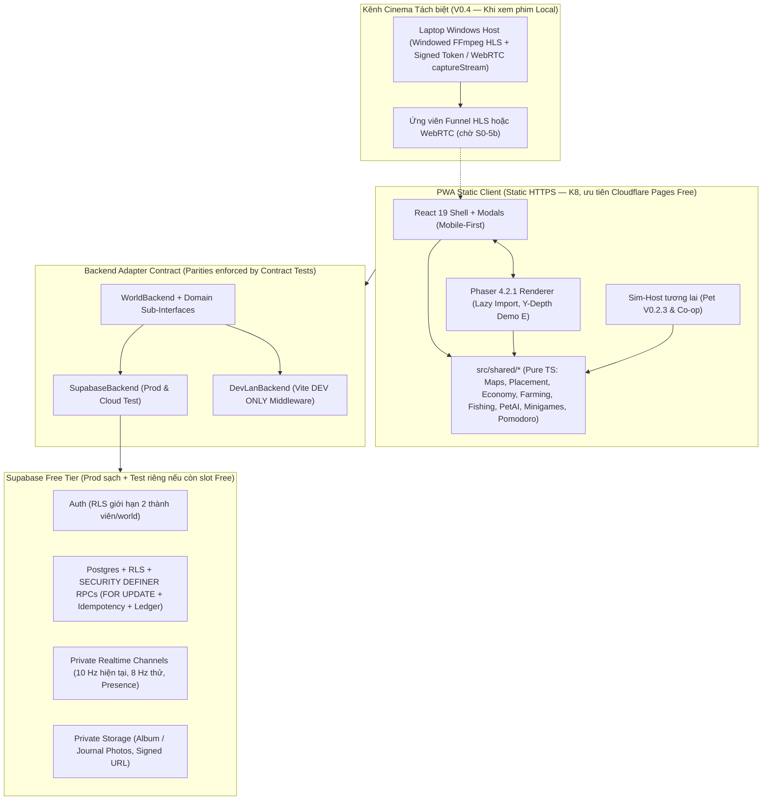

# Tổng quan Kiến trúc Mục tiêu (`ARCHITECTURE_OVERVIEW`)

*Bản đồ cấp cao **K1–K8** cho mở rộng dài hạn (`V0.1 → V1.0+`). Chi tiết cấu trúc V0.1 đang chạy xem tại [ARCHITECTURE.md](ARCHITECTURE.md).*

## 5 Nguyên tắc Bất biến Khi Mở rộng
1. **Logic thuần TS nằm ở `src/shared/` (`K1`):** Zero import `React`/`Phaser`/`DOM`/`Supabase` → Vitest test trực tiếp trong vài mili-giây.
2. **Mọi đột biến tài sản đi qua RPC khóa hàng + Idempotency (`K2`):** Postgres `FOR UPDATE` + `economy_ledger` chặn double-spend và xung đột 2 người mua cùng lúc.
3. **Không server 60 FPS (`K3–K4`):** Tải nhẹ trên Free Tier bằng công thức catch-up timestamp ở DB + bầu **Sim-Host** client phát `Intent` tần suất thấp (`<= 0.3 Hz`), đo TX avatar ở 8 Hz và đếm lượt nhận trước khi kết luận về quota.
4. **Tách Project Dev & Prod (`K6`):** Giao diện Dev Console bị dead-code elimination khỏi `dist/` và các RPC `dev_*` chỉ cài trên project Supabase Test.
5. **Chỉ giữ Cinema phụ thuộc laptop Host (`K8`):** Mọi tính năng game, học tập, pet, nhật ký dùng Cloud Free Tier khi project hoạt động mà không đòi máy tính bật.

Sơ đồ là kiến trúc mục tiêu. Production hiện tại đóng vai trò V0.1 với `WorldBackend`, Supabase adapter và starter CC0. Xem [tiến độ](PROGRESS.md) để biết phần đã chạy. Việc thêm domain diễn ra theo backlog, trải qua kiểm thử Dev LAN và SQL Test.
