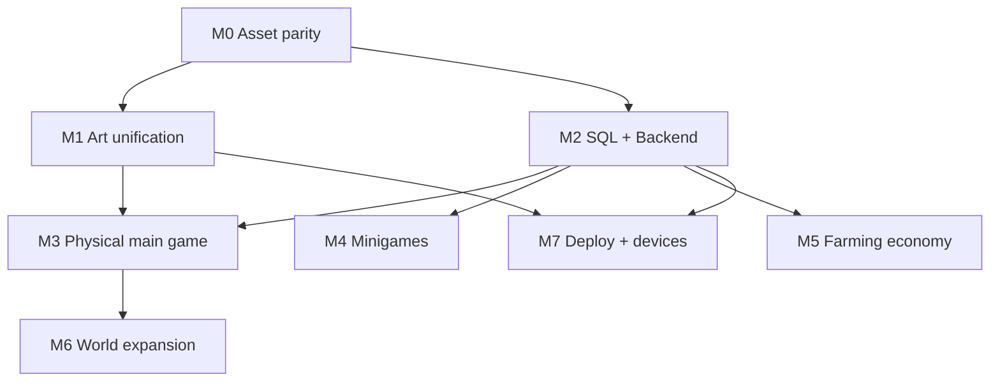

# Cursor Development Roadmap — Sau Mission 01 Handover

Mục tiêu dài hạn: cozy game đồng nhất **một** shell gameplay (không hai scene lệch chất lượng), hai người chơi, persistence thật, art Demo E có quyền rõ ràng.

**Không** triển khai hàng loạt trong Mission 01 — roadmap này là thứ tự ưu tiên cho các PR tiếp theo trên `integration/night-merge`.

---

## M0 — Cloud & Asset Parity (P0, chặn Demo E)

**Mục tiêu:** Cursor Cloud và CI tái tạo được pipeline Neon local.

| Deliverable | Acceptance criteria | Phụ thuộc |
|---|---|---|
| Tarball tối thiểu 40 file Demo E | `npm run assets:check-demo-e` exit 0 | `assets:pack-demo-e-minimal` trên máy chủ |
| Private atlas + build | `assets:atlas:private` + `build:private` exit 0 | Nguồn extract |
| **Hai guard tách biệt** | `verify-prod-guard.mjs` → `dist/` không có private; `verify:private` → `dist-private/` có atlas | Scripts handover |
| `OLW_PYTHON` / Pillow / Playwright | Lint/test/build public + Playwright xanh | Cloud env |

---

## M1 — Art unification (P0)

**Mục tiêu:** Game chính nhìn như Combined Experience (không chỉ sandbox).

| Deliverable | Acceptance criteria | Phụ thuộc |
|---|---|---|
| Cắt 16 `path_dirt_*` + `grass_edge_*` vào `props-manifest.json` | Tilemap 64/96 vẽ đường mượt, không rectangle debug | M0, `OLW-010-01` backlog |
| Gộp renderer: `WorldScene` dùng cùng prop/shadow/ambient helpers như Expansion | Screenshot diff giảm; E2E `v01` vẫn 8/8 | M0 |
| Chọn profile art: public (CC0+CC BY) vs private dev | PD-01 ghi trong `DECISIONS.md` | Chủ dự án |

*Không* bật sandbox vào production bằng cách gỡ dev guard.

---

## M2 — Integration Master: SQL + Backend (P0)

**Mục tiêu:** Một chuỗi migration, Dev LAN ≡ Supabase contracts.

| Deliverable | Acceptance criteria | Phụ thuộc |
|---|---|---|
| Reconcile `20261125000100` GPT vs Neon | Một file/sequence; `supabase/tests/*` pass trên Postgres 15+ | Neon review |
| Apply V0.1.5 migrations trên Supabase Test | Inventory security SQL + concurrency pass | `OLW-010-05` |
| Wire `petPrimitivesAdapter` → `petAdvanced/primitives` | `petLab` + main pet cùng contract; tests DeepSeek pass | DeepSeek handover |

---

## M3 — Physical life trong game chính (P1)

**Mục tiêu:** WASD/J/K/1-8 và chăm sóc vật lý không chỉ `experience-demo`.

| Deliverable | Acceptance criteria | Phụ thuộc |
|---|---|---|
| Port `interactionResolver` + `HeldItemRenderer` vào `WorldScene` | Feed/play/bowl trên home/garden; E2E mở rộng | M1 |
| `GameHotbar` + `ContextualPromptBadge` trong `App.tsx` | Mobile không đè joystick (đã fix một phần V0.1.5) | M1 UI tokens |
| Pet intelligence: adapter thật | Không anti-sleep loop giả; `petLivingIntelligence.test` giữ pass | M2 |

---

## M4 — Minigames & couple play (P1)

| Deliverable | Acceptance criteria | Phụ thuộc |
|---|---|---|
| `MinigameBackend` + invite từ menu | Hai client Dev LAN chơi Caro; Battleship privacy theo `GPT_INTEGRATION_REVIEW` | M2 |
| Không thưởng kinh tế cạnh tranh | `PRODUCT_SPEC` mini-game tự nguyện | — |

---

## M5 — V0.2 Farming & economy (P2, sau nghiệm thu V0.1)

| Deliverable | Acceptance criteria | Phụ thuộc |
|---|---|---|
| `garden_plots` persistence + UI ô đất | 12 ô; plant/water/harvest; `farming.test` + server | M2, cân bằng pacing DeepSeek §5 |
| `EconomyBackend` buy/sell/forage | Simulator oracle khớp RPC | OLW-020 |
| Fishing / cooking wire | FSM + UI tối thiểu | V0.2.2+ |

---

## M6 — World expansion production (P2)

| Deliverable | Acceptance criteria | Phụ thuộc |
|---|---|---|
| Landmark gameplay (5 vùng) hoặc honest "chưa mở" | Không nút giả | Design `WORLD_EXPANSION_DESIGN.md` |
| Map size quyết định 64 vs 96 | Performance mobile OK | Chủ dự án |

---

## M7 — Real device & deploy (P0 gate ship)

| Deliverable | Acceptance criteria | Phụ thuộc |
|---|---|---|
| `OLW-010-05` HTTPS + Auth PD-08 | 2 tài khoản, outsider blocked | Secrets chủ dự án |
| `OLW-010-06` iPhone PWA + 2 máy WAN | `MILESTONE_ACCEPTANCE` §1 | M7 deploy |

---

## Dependency graph (rút gọn)

## Ghi chú ưu tiên cho chủ dự án

1. **Quyết định art:** mèo (Quýt/Mochi/Bông), UI (Cottage/Storybook), map 64/96 — chặn M1/M6.
2. **Cung cấp asset tarball** — chặn M0 và parity `build:private`.
3. **Không merge handover vào `integration/night-merge` tự động** — review PR `cursor/cloud-handover-36fd` 