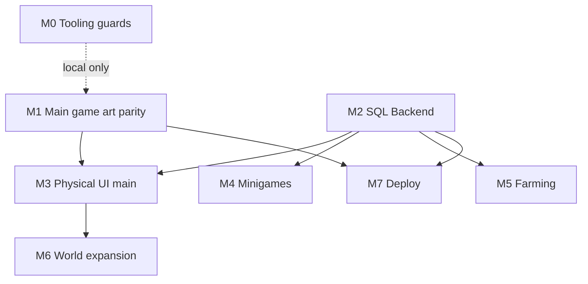

# Cursor Development Roadmap — Sau Mission 01 Handover

Mục tiêu dài hạn: **một game chính** với chất lượng mỹ thuật Demo E (như Combined Experience khi có atlas), không phải chuyển production sang sandbox dev-only hoặc hạ chất lượng main xuống public atlas nhỏ.

## Nguyên tắc ưu tiên (sau independent review)

1. **Chuẩn mỹ thuật:** Game chính (`WorldScene` + shell `App.tsx`) = renderer/interaction giàu như Combined Experience, **không** thay main bằng sandbox có pipeline riêng rồi bỏ dev guard.
2. **Tích hợp có chọn lọc:** Hotbar, physical care, notebook, expansion map — **port vào main**, không tách hai scene vĩnh viễn.
3. **Asset private:** Demo E parity (`build:private`, `verify:private`) chạy **trên máy chủ dự án đã xác minh license** — **không** blocker cho SQL (M2), domain V0.2, Pet AI, gameplay implementation trên Cloud khi thiếu pack.
4. **Không upload asset chưa xác minh** lên Cursor Cloud; cloud tiếp tục dùng unified public + Dev LAN.
5. **Hai guard build:** `verify-prod-guard.mjs` (`dist/`) ≠ `verify-private-build.mjs` (`dist-private/`); private atlas **trên disk**, **không** trong SW precache (Vite `globIgnores`).

---

## M0 — Tooling & guards (P0, không chặn logic)

| Deliverable | Acceptance | Ghi chú |
|---|---|---|
| `verify-private-build.mjs` | Atlas trong `dist-private/`; precache **không** chứa `private-unified` | Không đổi VitePWA chỉ để pass |
| `assets:check-demo-e` / pack minimal | 40 file; chỉ máy local | Cloud: exit 1, không giả pass |
| `resolve-python.mjs` + Pillow | Atlas private + E2E GIF | `OLW_PYTHON` = executable; `OLW_PYTHON_ARGS=-3` với `py` |

*M0 asset tarball là **local optional** — không nằm critical path M2–M5.*

---

## M1 — Art unification vào game chính (P0)

**Mục tiêu:** `WorldScene` đạt visual parity với Homestead/Combined (private atlas hoặc public đã nâng PD-01), **một** đường render.

| Deliverable | Acceptance | Phụ thuộc |
|---|---|---|
| Gộp helpers Expansion → `WorldScene` | E2E `v01` 8/8; screenshot art diff giảm | Atlas (local hoặc public approved) |
| 16 `path_dirt_*` trong props manifest | Đường mượt 64/96 | M0 local hoặc art task |
| Đưa interaction/hotbar vào main shell | Cùng UX Combined, không URL `experience-demo` bắt buộc | M3 overlap |
| **Không** ship sandbox làm production | Dev guard vẫn loại sandboxes khỏi `dist/` | — |

---

## M2 — Integration Master: SQL + Backend (P0, **không phụ thuộc M0 asset**)

| Deliverable | Acceptance |
|---|---|
| Reconcile migration `20261125000100` | SQL tests pass |
| V0.1.5 trên Supabase Test | Inventory security |
| Pet primitives adapter → DeepSeek | `petPrimitives.test` + main contract |

---

## M3 — Physical life & UI game chính (P1)

Port từ Combined Experience **vào** `App.tsx` + `WorldScene` (feed/play, prompts, notebook stub) — chất lượng art theo M1, logic theo M2.

---

## M4 — Minigames & couple (P1)

Backend PvP; UI smoke đã có qua `minigames.html` E2E; multiplayer E2E sau M2.

---

## M5 — Farming & economy (P2)

Domain đã có; wire sau V0.1 nghiệm thu — **không** chờ private atlas.

---

## M6 — World expansion production (P2)

Landmark gameplay hoặc “chưa mở”; map 64/96 — chủ dự án.

---

## M7 — Deploy & thiết bị thật (P0 ship gate)

HTTPS, PWA iPhone — sau M1 art chốt profile deploy.

---

## Dependency graph (cập nhật)

## Chủ dự án

1. Art quyết định (mèo, UI, map) — M1/M6.
2. Tarball minimal + `build:private` + `verify:private` — **local**, không bắt buộc cho Cloud agent SQL/gameplay.
3. Review PR #1; không auto-merge.